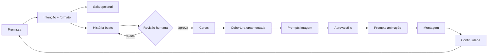

# OS LESADOS — AUDITORIA INTEGRAL

**Data:** 2026-10-14. **Repositório:** `/Users/leonardopaiva/Desktop/HQ Leonardo/Os-Lesados`.
**Método:** inspeção direta de código e dados — ficheiros de backend lidos na íntegra;
`index.html` (2153 linhas) lido por secções + `grep` de referências cruzadas; `node --check`
em todos os módulos; chamadas HTTP seguras e sem custo (`/api/health`, `/api/context/status`,
leitura de sessões); zero execuções com efeitos colaterais.
**Regras cumpridas:** nenhum ficheiro de produção alterado, movido ou apagado; nenhuma quota
de IA consumida; nenhum segredo reproduzido; nenhuma hipótese apresentada como facto —
**[EVIDÊNCIA]** = visto no artefacto citado; **[HIPÓTESE]** = inferência assinalada.
A única criação é este ficheiro.

---

## 1. Resumo executivo

1. O projeto é **uma página única (`index.html`, 2153 linhas, sem framework nem build) + backend
   Express fino + pastas de contexto/research/tools**. Sem testes automatizados; migração resume-se
   a um bump de string de versão; **o git só versiona `index.html` e `README.md`** — backend,
   contexto, research e tooling vivem apenas no disco, sem nenhum commit.
2. **A criação de episódios é 100% IA remota** (`aiGenerateEpisode` → `POST /api/story/generate`
   → beats validados → takes). Existe **um só botão de criação**; sem backend/chave/quota, nada
   se cria (erro explícito — comportamento correto).
3. **Maior cluster de dívida:** ~350 linhas de motor clássico morto (`buildScenes` + template de
   14 takes, `patchCast`, `SIG_LINES`, `sigDialogue`, `DIALOGUE_BANK`, `consumeLine`, `GOALS`,
   `premiseSlots`, `buildStoryLocal`) + `updateVideoTab` definida 2× + ramo morto `pair` no
   Video + comentários de designs abandonados. Nada disto executa; tudo isto induz em erro
   quem lê (incluindo futuros agentes).
4. **Maior risco arquitetural:** validação semântica só no caminho `/api/story/generate`.
   O caminho da **Sala aceita qualquer JSON parseável** (validador desligado com schema
   custom + normalizadores tolerantes) — propostas ocas fecham sessões "done" sem erro.
5. **Maior risco operacional:** tudo depende de quotas/creditos externos; quando falham, os
   erros são explícitos (bom), mas **não há degradação funcional** — sem IA não há episódio novo.
6. **Maior risco de conteúdo silencioso:** 4 chaves de cenários + 2 de personagens apontam para
   **ficheiros inexistentes**; o backend avisa no console e gera na mesma sem a referência.
7. **Preservar:** pipeline de imagem multip provider sem retries escondidos; `currentEpisode()`
   sem fallback silencioso; numeração por temporada; eliminação do modo clássico da UI em vez
   de placebo; sessões da Sala em disco com retoma; aprovar/rejeitar sem tocar em episódios.

---

## 2. Inventário da arquitetura atual

| Caminho | Linhas | Papel | Estado |
|---|---|---|---|
| `index.html` | 2153 | App inteira: UI+CSS+JS (motor, renders, Sala) | Ativo |
| `server/nano-banana-proxy.mjs` | 251 | Express, 13 rotas, serve `/` | Ativo |
| `server/image-pipeline.mjs` | 66 | Prompt+refs → provider → normalização | Ativo |
| `server/context.mjs` | 155 | Manifests, skills, estilo, refs, status | Ativo |
| `server/providers/{gemini,openai,huggingface,cloudflare}.mjs` | 141/127/90/100 | 4 providers imagem, 1 interface | Ativo |
| `server/providers/index.mjs` | 47 | Registry + resolve + status | Ativo (comentário com 3 providers, código com 4) |
| `server/text-providers/{gemini,openai,anthropic}.mjs` | 200/74/83 | 3 providers texto JSON | Ativo |
| `server/text-providers/index.mjs` | 62 | Router openai→anthropic→gemini + fallback | Ativo (comentário omite anthropic; msg erro omite ANTHROPIC_API_KEY) |
| `server/writers-room/{agents,orchestrator,search}.mjs` | 191/303/89 | 6 agentes + estados + pesquisa real | Ativo |
| `server/writers-room/sessions/*.json` | 11 ficheiros | Sessões (sem limpeza) | Ativo, a acumular |
| `context/*` | — | 9 retratos-ish + 17 backgrounds + manifests + skills + style + canon | Ativo (6 refs quebradas, §6) |
| `research/*` (13 .md, 874 linhas) | — | Storylines, figures, formatos, HANDOFF | Referência |
| `tools/*.py` (2) | 120/270 | Análise takes (cv2) + análise estilo YouTube | Utilitários |
| `package.json` (+lock v3, deps==lock) | — | express, cors, dotenv, @google/genai ^2.28.0, Node v24 | OK |
| `.env` / `.env.example` (37 linhas) | — | Segredos (ignorado, não tracked) / placeholders (6× `replace_with…`, sem valores) | OK |
| `README.md` (20 bytes, "Comic") | — | Stub do template original do repo | Órfão inofensivo |

**Git: `git ls-files` = só `index.html` + `README.md`; 2 commits históricos inócuos
(projeto reaproveitado). Untracked: `.env.example`, `.gitignore`, `context/`, `package.json`,
`package-lock.json`, `research/`, `server/`, `tools/`; `index.html` modificado sem commit.**
`.env` coberto por `.gitignore:2` (verificado via `check-ignore`). Grep por prefixos de
chaves em código/docs/manifests: **zero ocorrências**. Nota fora-do-repo: chaves circularam
em chats desta máquina em sessões anteriores — rotação recomendada (§18.7).

---

## 3. Mapa do fluxo de dados e das dependências

```
Sidebar (nome+premissa, provider/modelo Seletor)
 │ aiGenerateEpisode (index.html:1222) — ÚNICO caminho de criação
 ▼ POST /api/story/generate {premise, castIds=detectCast local}
nano-banana-proxy.mjs:74 → textRouter.generateJSON({system: storySystemPrompt(fichas da bíblia),
 user: premissa (800 chars) + elenco + nº beats}) → validate: validateStory
 │ router openai→anthropic→gemini; 1ª falha não-400/401 tenta o seguinte; erro final agregado
 ▼ {story} → normalizeAIStory (nomes→ids, locais→8 chaves, paren:"", dur:6, reframe só sem fala)
 ▼ storyToScenes (beats→takes n1..nX, shot por kind, clamp 4–8s, timecodes sequenciais)
 ▼ narration/tagScene/coldOpen (+hook SÓ via normalize em reload) → auditStory + audit
 ▼ localStorage["osLesados_html"] → renders (Guião/Pipeline/Video/Canon) + header nav
Take aprovado → POST /api/generate-image {prompt(editável), provider, model, references[reframe-base],
 sceneContext} → image-pipeline: buildFullPrompt(prompt+skills+style) + loadDiskRefs →
 provider.generate → dataURL no take → aprovar → Video (buildVideoPrompt OMNI FLASH, cópia manual)
Sala: POST /writers/start → run em background → polling GET session/:id (3s) → approve →
 "Usar no guião" preenche nome+premissa (NÃO cria episódio)
```

Dependências externas (sem mocks/cache/fila): Google AI Studio, OpenAI, Anthropic,
Cloudflare Workers AI, HuggingFace Inference, Wikipedia API, DuckDuckGo HTML.

---

## 4. Auditoria do motor narrativo

### 4.1 Funções reais e estado

| Função | Local | Estado verificado |
|---|---|---|
| `detectCast` + `CAST_KEYWORDS` | 545– | **ATIVA** — único resto local em produção; define `castIds` do pedido |
| `normalizeAIStory` + `mapWhoToId`/`mapLocToKnown`/`stripSpeaker` + `STORY_LOCS` | 1032–1085 | **ATIVA** |
| `storyToScenes` + `SHOT_BY_KIND` | 926–975 | **ATIVA** |
| `auditStory` + `salientKeys`/`contentWords` | 977–1030 | **ATIVA na criação; NÃO recorre em reload** (só `audit()` formal, linha 517) |
| `audit` (formal) | 1192 | **ATIVA** — banidos, ≤8s, ALERTA MEL, reframe↔local |
| `buildStoryLocal`, `buildScenes`, `patchCast`, `SIG_LINES`, `sigDialogue`, `DIALOGUE_BANK`, `consumeLine`, `GOALS`, `premiseSlots` | 583–820 | **MORTAS** — 1 ocorrência cada (só definição), zero callers |
| `normalize` + migração v1→v2 | 484–520 | **ATIVA** — re-sanitiza tudo a cada load; backfill `story:null`/hook/narração |
| `currentEpisode` | 1213 | **ATIVA e sã** — `null` sem fallback silencioso |
| `aiGenerateEpisode` / `expandWithAI` | 1222 / 1100 | **ATIVOS** — criar / reescrever (com confirmação se há aprovados) |
| `buildTagScene` (`premise` ignorado), `pickColdOpen`, `buildNarration`, `pickSeasonHook` | 1281 / 385 / 408 / 371 | **ATIVAS**; `hook` só nasce no `normalize`, nunca na criação |
| `resolveOfficeSide` + `OFFICE_*` + `locBase` | 422–429 | **ATIVA** (normalize + storyToScenes) |

### 4.2 Fluxo real, decisão a decisão

1. **Fixo:** validações de campos, elenco (`detectCast` ou `[coxa,claudio]`), época/numeração.
2. **IA:** beats, diálogos, clímax, resolução, punchline (com `temperature: 0.9` nos 3 providers).
3. **Determinístico:** mapeamentos, kinds **por posição** (primeiro=setup, penúltimo=climax,
   último=resolution), `with` por rotação, durações, shots, timecodes, narração/timecards/
   coldOpen sorteados, tag por presença.
4. **Auditoria:** narrativa + formal na criação; só formal nos reloads.

### 4.3 Perdas, duplicações e reconstruções

- **Perde-se:** direção vocal da IA (`paren: ""`), durações da IA (`dur: 6` fixo), pares
  previstos pela IA (`with` por rotação), `guestLines` do schema (lido mas nunca usado).
- **Duplica-se:** elenco (frontend `detectCast` + backend aceita `castIds` sem validar
  contra nada além de existência na bíblia); auditoria corre 2× lógicas sobrepostas.
- **Reconstrói-se:** `prompt` visual por take via `buildPrompt` (bem); narração/timecards/
  coldOpen sorteados de novo se ausentes (aceitável).

### 4.4 Estrutura imposta antes da premissa

`normalizeAIStory` atribui `kind` por **posição**, não por conteúdo — uma história de 1
situação, fria aberta no clímax ou antologia sai deformada. `storyToScenes` dá 1 master
por beat sempre; sem beats não há takes. **Conclusão (§4 do pedido): o modelo de 6 beats
posicionais não é adequado como invariante**; o schema (3–9 beats) permite flexibilidade
que a normalização destrói. Proposta em §12.

---

## 5. Auditoria de cenas, masterframes, takes e reframes

### 5.1 Conceitos: pedido vs código

| Conceito pedido | Representação real | Veredicto |
|---|---|---|
| Cena (unidade narrativa) | **Inexistente.** `scenes[]` são takes; sem objeto cena | Confusão estrutural — renomear ou criar |
| Masterframe | `type:"MASTER SHOT"` em **todos** os takes de `storyToScenes` | Etiqueta vazia; tudo é master |
| Take/plano | item de `scenes[]` (id, shot, camera, duration, action, dialogue) | OK — unidade real |
| Reframe | `reframeOf` + texto "MESMO MOMENTO"; nasce **só sem diálogo** | OK mas restritivo (nunca cobre diálogo) |
| Plano de reação | Sem tipo; reframes fazem o papel às vezes | Lacuna de vocabulário |
| Initial/final frame | `buildVideoNote`/`needsFinalFrame`/`endFrameHint` (1477–1502) | OK, só nota operacional |
| Prompt imagem/animação | `buildPrompt` / `buildVideoPrompt` (538 / 1516) | **Boa separação** — camada mais sã do projeto |

### 5.2 Como se decide a cobertura hoje (resposta direta)

Não se decide: 1 beat = 1 take (+1 reframe mudo se sem diálogo). `buildVideoClips()`
(1547) devolve sempre 1 take por clip; o ramo `pair`/INITIAL+FINAL no `renderVideo`
**nunca executa** (`pair` sempre falso) com comentários de design abandonado por cima.
`VIDEO_COVERAGE` conhece **uma** sala (1506–1515). `transitionFor(s, s.id==="6a")` nunca
dispara finale em takes `nX`. Cobertura por cenário existe só como texto de nota.

### 5.3 Duração e orçamento (resposta a §6 do pedido)

- Duração **não** resulta da história: takes IA sempre 6s (reframe 5s); só o nº de beats
  (3–9) mexe no total. Fala (~4s+2s/voz), pausas, reações e transições não entram no cálculo.
- Exceder 120s (ou 300s futuros) é impossível por construção atual — mas por rigidez, não
  por orçamento: mais história = mais beats de 6s, nunca takes mais densos.
- Custo de produção (nº imagens) ≈ nº takes com imagem; reframes mudos geram imagem na
  mesma — sem distinção custo narrativo vs cobertura.
- Proposta: durações por função (fala 4s+2s por voz extra; ação 3–6s; reação 2–3s; tag 5s),
  teto configurável por episódio, reframe reutiliza still do master quando só muda o
  enquadramento (hoje gera sempre imagem nova se o utilizador clicar).

---

## 6. Auditoria de personagens, canon e contexto

### 6.1 Fontes (9 personagens: teresa, tininha, claudio, capitao, abelha, coxa, mario, patribunal, perpetua)

| Fonte | Usada onde | Estado |
|---|---|---|
| `index.html` array (visual+voice EN) | prompts, Canon, builders | **Única fonte runtime do frontend** |
| `context/canon/personagens.json` (role, goals, humor, limits, relations, catchphrases…) | system prompt IA + `/api/canon/bible` | **Parcial:** `mannerisms`, `relations`, `limits`, `catchphrases` nunca saem do JSON |
| `context/characters/dev/*.md` + `IDEIAS-covil.md` | nada (trabalho) | OK fora do runtime |
| `research/figures.md` (nomes reais, R1–R11) | nada (investigação isolada, regras explícitas) | OK; risco se alguma R avançar sem sala |
| Bíblias V2 externas | nada versionado | Dependência externa não versionada |

### 6.2 Contradições e lacunas ([EVIDÊNCIA] verificadas em disco)

- **Retratos em falta com chave presente:** `tininha.jpg`, `perpetua.jpg` (manifest
  `context/characters/manifest.json` refere, disco não tem). `mario-galatico.jpg` existe.
- **Cenários em falta idem:** `sala-controlo.jpg`, `zona-catering.jpg`,
  `exterior-estacao.webp`, **`camarim.jpg`** — este último com agravante: `camarim-espelho.jpg`
  **existe** mas só é alcançável pela chave longa "Camarim (POV espelho…)"; a chave curta
  "Camarim" aponta para o vazio. Backend avisa no console e gera sem referência.
- **Vozes provisionais eternizadas:** coxa, patribunal ("pending writers' room"), perpetua
  ("no canon cover yet") — sem dono nem prazo, a renderizar como texto final no Canon.
- **Precedência por omissão:** com foto vence o .jpg; sem foto vence o texto do frontend;
  a bíblia JSON quase não influencia visuais. `relations` nunca entram em prompts, takes ou auditoria.
- **Nomes reais:** `sanitize()` + `audit()` cobrem os 4 confirmados; suggestions (18) limpas.
  **Furo real:** falas/ações da IA entram via `normalizeAIStory` **sem `sanitize`**
  (só `stripSpeaker`) — nome real cuspido pelo modelo chega ao guião e só é apanhado
  *a posteriori* pelo `audit()`. Teste: mock com nome real deve ser adicionado (§16).
- **Continuidade inter-episódios:** só decorativa (`hook` rotativo por número, atribuído no
  reload e não na criação; "Season 1" hardcoded no render apesar de `ep.season` existir).
  Sem log de eventos, sem callbacks verificados, sem memória de arcos.

### 6.3 Como personagens *deveriam* influenciar (requisito §7)

Objetivos→`want` dos beats (hoje: só via texto livre da IA, sem verificação); decisões→
escolhas registadas por beat (hoje: `does` textual, sem estrutura de decisão); poder→ sem
representação (relações da bíblia inutilizadas). Proposta: `beats[].decisao {quem, opções,
escolhida, porquê}` + auditoria de agência (cada estrela decide ≥1 vez) — ver §15.

---

## 7. Auditoria da Sala dos Argumentistas

### 7.1 Funções distintas? **Sim, verificado specialty por specialty.**

Investigador (queries fixas: tópico + sites TVI + fofocas + técnica; `research()` agrega com
`kind` facto|tecnica) → Analista (factos + bíblia + cenários → combos) → Argumentista
(combos + técnicas → 10 premissas, 2 absurdas) → Improvisador (≤3 premissas, twists) →
Crítico (≤3, score+flaw+fix) → Revisão (≤2 piores) → Showrunner determinístico (score,
bónus absurdo-com-payoff, corte ≥6, top-5). Paralelismo real via `Promise.all` nos bursts;
sequencial onde há dependência. Mensagens do feed correspondem a chamadas reais (1 por etapa).

### 7.2 Custos, quotas, alternativas, offline

- Sessão típica ≈ 8 chamadas de texto + pesquisa gratuita; teto `MAX_AI_CALLS=10`,
  timeout 150s/chamada, sem controlo em dinheiro; `checkStop` só entre etapas.
- Router tenta openai→anthropic→gemini e agrega erros (bom); sem providers locais nem fila.
- 11 sessões acumuladas sem limpeza; retoma funciona; `stop`/`continue` verificados nas rotas.
- Auto-arranque ao abrir a aba (1/dia, tópicos rotativos, opt-out) — risco de erro visível
  sem quota, aceitável e explícito.

### 7.3 Para ser processo de trabalho falta

(a) shortlist→episódio perde elenco/payoff/crítica ("Usar no guião" só preenche nome+premissa);
(b) decisões sem justificação guardada (só `state`); (c) auditorias de episódios nunca
realimentam a Sala; (d) `applyRevisions` **sobrescreve** título/premissa/payoff sem histórico
de versões; (e) sem comparação lado-a-lado de versões.

---

## 8. Auditoria de providers e persistência

### 8.1 Texto — matriz verificada no código

| Provider | Modelo default | JSON | Validação real | Estado |
|---|---|---|---|---|
| openai-text | `gpt-4o-mini` | `json_object` (sem schema!) | só se caller passar `validate` | story path passa ✓; agentes **não passam** ✗ |
| anthropic-text | `claude-haiku-4-5` | parse manual + strip markdown | idem | idem |
| gemini-text | `gemini-2.5-flash` | `responseJsonSchema` + MIME | `validate = schema ? noop : validateStory` — **com schema custom, validação desligada** | agentes sem validação real |

**Nenhum retry em nenhum provider** (confirmado por leitura integral; timeouts 120–180s via
`AbortSignal`). Erros 401/429/502 mapeados com mensagens acionáveis; 400/401 quebram a
cadeia do router (correto). `temperature: 0.9` em JSON estruturado aumenta risco de
JSON inválido — mitigado só por `try/catch` de parse.
Doc drift: `providers/index.mjs` e `.env.example` falam em 3 providers de imagem (são 4);
`OPENAI_IMAGE_QUALITY` usada no código, ausente do `.env.example`; mensagem de erro do
router omite `ANTHROPIC_API_KEY`.

### 8.2 Imagem — interface comum honesta, 1 diferença real

Só o `openai` (gpt-image edits multipart) usa referências de imagem; HF e Cloudflare
ignoram-nas **com warning explícito** (correto); Cloudflare trunca a 2048 chars avisando.
Gemini: Interactions v2 + fallback generateContent, aliases Nano Banana→modelos reais.
`IMAGE_SIZE` só viaja no Gemini; tamanho HF/CF fixo no código. Sem retries. Sem validação
de conteúdo da imagem (obviamente — sem vision check).

### 8.3 Persistência

Episódios em `localStorage["osLesados_html"]` sem schema versionado (só string `version`;
migração v1→v2 adiciona `story:null`). Sem export/import/backup — perda total se o
navegador limpar dados. DataURLs de imagens contam para os ~5MB de quota; `save()` em
`try/catch` com toast genérico. Reset limpa episódios mas não sessões (correto).
`currentScene` pode apontar para take apagado? Verificado: `renderPipeline` usa
`ep.scenes.find(...) || ep.scenes[0]` — tolerante. **Risco não confirmado:** corrupção de
JSON em `load()` é engolida em silêncio (`catch(e) {}`) e arranca estado vazio — perda
silenciosa total; propor backup da última string válida.

---

## 9. Auditoria de interfaces e pipeline visual

Ativas e sãs: 5 abas; gerar com IA (valida, loading, erro explícito, nada criado em falha);
reescrever com deteção de ideia nova + confirmação sobre aprovados; testar backend; ver
contexto (**ignora `skills`/`style` devolvidos pelo backend** — dado pedido e não mostrado);
pipeline com nav Season/Episódio + delete ✕, prompt editável por take (usa-se o editado na
geração ✓), gerar/regenerar/aprovar; Video com copy individual+total; Canon textual;
header com ticker; 18 sugestões; Habbo-room + temas na Sala.
Mortas/duplicadas: ramo `pair` no Video; `updateVideoTab` ×2; comentários de design morto.
Controlos de efeito parcial: seletor de modelo (tamanhos fixos por provider no código).
Revisão exigida pelo briefing: **história e takes não editáveis** (só re-geração total) e
**guião por take não editável** — os dois pontos centrais do §10 falham; só o prompt de
imagem é editável.
Navegação/persistência por ação (`save()` em cada mutação) — voltar atrás não perde trabalho.

---

## 10. Principais problemas e causas

1. Validação só no caminho feliz da história; Sala aceita qualquer JSON (causa: validador
   desligado + normalizadores tolerantes). → Sessões "done" ocas.
2. Recursos referenciados inexistentes (causa: manifests editados à mão sem verificação;
   backend perdoa em silêncio).
3. Duração não deriva da história (`dur: 6` fixo; reframe 5s; total = 6×beats).
4. Voz/parênteses da IA descartados; `with` por rotação força presenças sem função.
5. `hook` órfão; `transitionFor` cego a takes `nX`; "Season 1" hardcoded.
6. Sem edição de história/takes; auditoria sem ação (ver→não corrige).
7. Zero testes automatizados; zero versionamento real (git com 2 ficheiros).
8. Quotas como ponto único de falha funcional (by design, mas sem modo degradado útil).

---

## 11. Arquitetura futura recomendada

Módulos com schemas versionados (`story.schemaVersion`, `episode.schemaVersion`):

```
premissa ──► INTENÇÃO (ideia cómica + elenco + duração-alvo + tom + formato classificado)
      ──► EXPLORAÇÃO [Sala opcional, custo visível] ──► HISTÓRIA (beats causais)
      ──► REVISÃO HUMANA OBRIGATÓRIA (editar beats/falas; nada gera sem aprovar)
      ──► CENAS (beats→cenas; 1 contexto; multi-personagem explícita)
      ──► COBERTURA (master → reações/inserts por regra; orçamento de takes)
      ──► PROMPTS (imagem por take aprovado; animação por clip aprovado)
      ──► APROVAÇÃO STILLS ──► ANIMAÇÃO ──► MONTAGEM
      ╰──► CONTINUIDADE (log eventos/episódio → próxima geração + Sala)
```



IA decide texto/diálogos/quantidade dentro de orçamentos; regras vetam (repetição, duração,
canon, nomes); humano aprova história, stills e clips. Anti-template: **classificador
premissa→formato** (1 situação / plano falhado / confronto / gala / investigação), cada
formato com o seu compositor; cenas/takes derivam, nunca o inverso. Duração: soma por função
(fala 4s+2s/voz, ação 3–6s, reação 2–3s, tag 5s) + teto configurável (120s→300s = mais beats,
não takes esticados). Compatibilidade: migração com `schemaVersion`, `story:null` renderiza,
modo sem providers = ler+editar+auditar (hoje inexistente — criar).

---

## 12. Exemplo prático (backstage de reality, sem episódio completo)

**Rígido (template):** 14 takes fixos; "quem fala" = quem o template manda; a confronto
entra sempre 3 personagens; IRIS OUT sempre. A premissa "o teleponto mostra a expulsa
errada" vira os mesmos 14 takes com nomes trocados.

**Recomendado:** classificador deteta *confronto em direto* → formato confronto:
beat1 setup (2 no estúdio) → beat2 incidente (teleponto erra) → beat3 cada um culpa o
outro → beat4 Abelha amplifica → clímax: Capitão decide no ar → tag: expulsa errada a
sair com segurança. 6 beats → 7–8 takes.

**Realização (`1`,`1a`,`1b`,`1c` ilustrativos, não obrigatórios):** master `1` (WIDE:
mesa, 5 sentados, posições/teleponto visíveis) → `1a` close-up de quem fala (diálogo) →
`1b` close-up de quem reage primeiro (reação cómica, sem fala ou continuação) → `1c`
insert no teleponto (revelação: o nome errado) → volta a `1` se entram todos em pânico.
Cada plano nasce de fala/reação/revelação; nenhum nasce do contador.

---

## 13. Plano de limpeza (por ficheiro; nada a executar nesta fase)

| # | Alvo | Ação | Verificação antes | Risco |
|---|---|---|---|---|
| C1 | 2ª `updateVideoTab` (l.1609–1613) | Apagar | diff das duas (idênticas, verificado) | Zero |
| C2 | Comentários header routers (3 vs 4 providers) + msg erro sem Anthropic | Corrigir texto | leitura | Zero |
| C3 | Ramo `pair` + comentários mortos (1541–1576) | Apagar | confirmar que clips multi-take não voltam (decisão §18) | Baixo |
| C4 | Cluster morto (~l.583–820: template+SIL/bank/GOALS/premiseSlots/buildStoryLocal) | Apagar após C5 | `grep` 1 ocorrência cada (feito) + migrar episódios v1 restantes + decidir modo offline (§18.4) | Médio (irreversível sem git!) |
| C5 | Antigos episódios `story:null` | Migrar ou arquivar | listar via script só-leitura | Baixo |
| C6 | Sessões `writers-room/sessions/` (11) | Rotação >30 dias | confirmar nenhuma como exemplo | Baixo |
| C7 | Docs superados (`HANDOFF`, partes de `formatos/`, `figures.md` R-ja-canonizadas) | Carimbar "histórico + data" | revisão humana | Baixo |
| C8 | Commitar tudo (`git add` + 1º commit real) | Fazer já | rever `git status` + `.gitignore` | Zero (só reduz risco) |

---

## 14. Plano de implementação faseado

**F0 — Segurança (1h, sem código de produto):** commit inicial completo; backup localStorage
(export/import JSON — ainda não existe!). Critério: `git ls-files` cobre `server/`,
`context/`, `tools/`, `research/`, configs. Fora de âmbito: mudar código.
**F1 — Higiene (C1–C3, C7):** duplicados, comentários, ramos mortos. Critérios: `grep`
limpo + `node --check` + smoke manual das 5 abas. Risco: mínimo.
**F2 — Validação da Sala (maior ROI):** `validate*` por agente no backend + falhar em vazio
em vez de normalizar; `applyRevisions` com histórico; shortlist→episódio preservando
elenco/payoff/crítica. Critérios: sessão mock com resposta vazia falha explicitamente;
proposta aprovada gera rascunho com elenco. Risco: médio (mexe contratos Sala↔UI).
**F3 — Motor narrativo real:** classificador premissa→formato; beats com `decisao`;
cobertura por regras (§5.3) com orçamento; durações por função; edição de história/takes
na UI; auditoria com ação (botão "corrigir" por issue). Critérios: testes §16 verdes.
Risco: alto — é o coração; fazer por trás de flag, manter fallback IA atual.
**F4 — Continuidade e escala:** log de eventos, memória inter-episódios, teto 300s,
export/import, testes. Risco: médio.
Fora de âmbito em todas: reformulação visual completa; novos providers; modo offline total.

---

## 15. Plano de testes e critérios de aceitação

Sem diretório de testes hoje (só harnesses manuais `node -e` em sessões passadas).
Propor `tools/test-*.mjs` com `node --test`:

1. **Determinísticos:** `detectCast` (12 premissas incl. limites), `normalizeAIStory`
   (mock: nomes→ids, locais→8 chaves, sem `paren`, reframe só sem-fala-mesmo-local),
   `storyToScenes` (timecodes sequenciais sem overlap, clamp 4–8s), `auditStory`
   (mock com repetição/disjunção/causalidade partida), `resolveOfficeSide` (tabela),
   `sanitize` (4 nomes + idempotência), `currentEpisode` null-safe, migrar v1→v2,
   router (ordens e agregação de erros com providers mockados via injeção).
2. **Narrativa por modelos:** só com quota dedicada e thresholds (não prova absoluta).
3. **Humana:** grelha cega A/B (motor atual vs novo, 3 premissas fixas: barco, veto, camarim).
4. **Produção visual:** still→clip→montagem de 1 episódio piloto fim-a-fim.
Critérios: T1–T3 verdes em CI local antes de qualquer merge; grelha humana decide o corte.

---

## 16. Riscos e questões por esclarecer

- R1: sem quota, zero criação — aceitar o modo atual ou investir em degradação (fila, retry com backoff, cache)? (§18)
- R2: `localStorage` sem backup: um `catch(e){}` vazio pode deitar fora temporadas inteiras.
- R3: commit inicial gigante sem revisão pode cristalizar segredos — verificar `git status`
  e `.gitignore` antes (feito aqui: limpo).
- R4: modelos mudam comportamento (temperature 0.9 + schemas frouxos) — respostas de hoje
  podem não reproduzir amanhã; testes com mocks, nunca asserts sobre texto do modelo.
- R5: figuras reais em `research/figures.md` — investigação legítima, mas qualquer avanço
  para canon sem sala é risco editorial e jurídico.
- R6: impossível confirmar sem browser real: rendering final, polling 3s, Habbo-room,
  copy-to-clipboard, `confirm()`s. Auditoria foi estática + HTTP.
- Não verificado: conteúdo integral de `research/storylines.md`, `figures.md` (amostragem),
  `tools/*.py` além do cabeçalho, `package-lock.json` além de consistência de deps.

---

## 17. Decisões que dependem do responsável pelo projeto

1. **Modo offline:** eliminar o cluster morto (L4/C4) ou ressuscitá-lo como fallback sem rede?
2. **Clips multi-take:** o ramo `pair` volta (e com que semântica) ou apaga-se?
3. **Real names:** manter regra absoluta mesmo com R-qualquer a pedir exceção?
4. **Quotas:** aceitar "sem saldo = sem episódios" ou investir em degradação (fila, retry com backoff, cache)?
5. **Duração:** teto 120s configurável já, ou esperar pelos 5 minutos?
6. **Sala:** shortlist deve criar rascunho de episódio automaticamente?
7. **Sessões antigas:** arquivar as 11 ou guardar alguma como golden-example?
8. **Commit inicial:** fazer já (recomendado) com que mensagem/branch?

---

*Fim do relatório. Gerado por inspeção direta em 2026-10-14, sem alterações ao código.*
